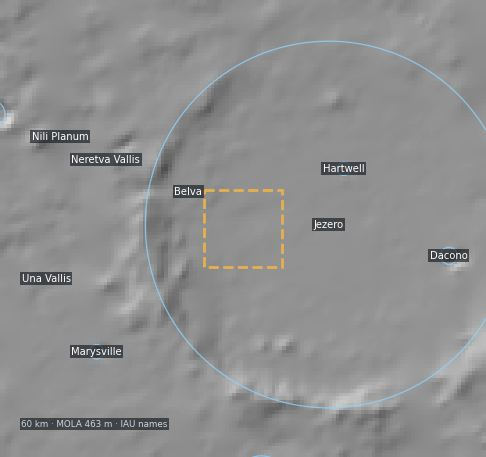
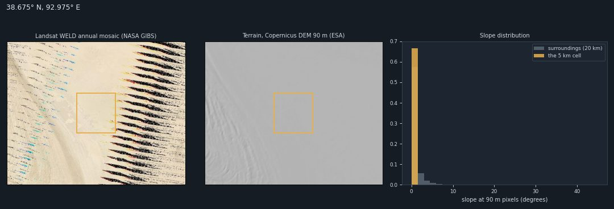

# Analog Finder

**NASA Space Apps Challenge 2026 · "Identify Earth Locations that Analog the Permanent Moon Base Locations and Mars"**

Where on Earth is most like a landing site or base candidate on the Moon or Mars? The Analog Finder gives every patch
of Earth's land – 8.9 million cells of about 5 km, with climate data for 2003–2024 – the same fingerprint as 27 target
sites on Mars and at the lunar south pole. It ranks Earth by how closely each patch matches, explains for every match
what fits and where the analogy breaks, and checks the best matches with satellite images, 90 m terrain and a
robustness test.

**[Open the web app](https://vice003.github.io/analog-finder/)** · [Site profiles](https://vice003.github.io/analog-finder/profiles.html) · [Glossary](https://vice003.github.io/analog-finder/glossary.html) · [Results (German)](https://vice003.github.io/analog-finder/ergebnisse.html) · [Technical description (German)](TECHNIK.md)

| Target area on Mars: Jezero crater | Best Earth analog: Qaidam Basin, China |
|---|---|
|  |  |

## What it does

* **27 targets:** 14 on Mars (landing sites of Perseverance, Curiosity, Opportunity, Spirit, InSight, Phoenix,
  Zhurong, finalist sites and the ice targets Arcadia Planitia and Deuteronilus Mensae) and 13 at the lunar south pole
  (NASA's Artemis III candidate regions, Shackleton and Cabeus). Each target is a 10 km (Mars) or 15 km (Moon) box.
* **Every Earth cell compared feature by feature:** terrain (slope, relief), surface material (albedo, thermal
  inertia), temperature, dryness, atmosphere, dust and wind, ice, vegetation and sunlight.
* **Fair comparison across worlds:** the same quantity measured the same way is compared value against value (terrain
  with the same code on all three bodies); different instruments are compared rank against rank; values Earth never
  reaches (vacuum, 6 hPa, no rain) count as "the closer, the better". Every value carries a reliability grade (A/B/C)
  that sets its weight.
* **Answers, not just scores:** top 20 Earth sites per target (at least 200 km apart), the best site on every
  continent, a list without China, the place among about 840,000 ranked cells, why each site matches feature by
  feature, why it belongs to its environment class, and what makes its terrain special.
* **Checks on the best matches:** robustness under 1,000 random weightings; site profiles for the 104 best sites
  (Landsat image, Copernicus DEM 90 m, slope distribution); a fine search for the best target-sized box within 8 km;
  a literature check of the sites labelled "new".

### Web app features

Mars and Moon maps to pick a target · world map of similarity · satellite view (NASA GIBS) with the cell and the
best box · target area with named craters · ranked list or best per continent · filters by environment class and
properties, "only robust sites", "exclude China" · your own weights for each dimension (re-ranked in the browser) ·
side-by-side comparison of up to 3 sites · explanations and a glossary for every term. One HTML file, no server.

## Key results

* **Mars → High Asia, then the Andes and the Sahara.** For the Mars targets the best matches lie on the Tibetan
  Plateau, in the Qaidam Basin and around the Taklamakan. Outside Asia the best sites lie in the Atacama/Altiplano
  (median place about 100 of 840,000), then the Sahara (about 400).
* **Moon → the Canadian High Arctic.** For the lunar south pole the best matches are ice-free polar deserts on
  Ellesmere and Axel Heiberg Island and in North Greenland, by a wide margin.
* **Positive control:** established analogs appear without the method knowing them – Qaidam Basin, Atacama, Altiplano,
  Salar de Uyuni, Axel Heiberg Island, Haughton crater.
* **Robustness:** the best site stays in the top 20 under at least 80 % of random weightings for 7 of 14 Mars targets
  and 11 of 13 Moon targets.
* **Fine search:** moving a target-sized box up to 8 km raises the terrain match from a median 0.86 to 0.94.

## Repository layout

| Folder | Content |
|---|---|
| `earth/` | Earth data: MODIS and MERRA-2 climatologies, Copernicus DEM terrain, the Earth feature table |
| `common/` | shared code for all three bodies: terrain statistics, body percentile |
| `planetary/` | target computation (`compute_targets.py`), `targets.json`, interface spec and checker |
| `scoring/` | environment classes and profiles, scoring, candidate pool, robustness, property flags |
| `results/` | top sites per target (JSON, CSV), candidate pool, robustness, fine search, literature check |
| `web/` | web app builder and template, site profiles, fine search, target views, results and glossary pages |
| `docs/` | the published site (GitHub Pages) |
| `derived/` | Earth features on the team's 10′ grid |

## Run it

```bash
pip install -r requirements.txt
python earth/download_modis.py --yes            # free NASA Earthdata login (earthaccess, ~/.netrc)
python earth/clim_modis.py lst && python earth/clim_modis.py ndvi && python earth/clim_modis.py snow
python earth/surface_static.py
python earth/clim_merra.py monthly && python earth/clim_merra.py daily && python earth/clim_merra.py precip
python earth/dem_features.py && python earth/dem_baselines.py
python earth/build_features.py                  # -> data/earth/earth_features_005deg.parquet
python planetary/compute_targets.py             # raw planetary data in data/planetary/raw (see script header)
python scoring/target_scoring.py planetary/targets.json earth_features_005deg.parquet   # ~30 min
python scoring/pool_flags.py && python scoring/robustness.py
python web/make_site_profiles.py && python web/fine_search.py && python web/make_site_profiles.py
python web/make_target_views.py && python web/make_profiles_page.py && python web/make_glossary_page.py
python web/build_web.py                         # -> web/index.html (copy to docs/)
python web/make_results_page.py results/top_sites.json web/ergebnisse.html
```

Raw and intermediate data (`data/`, several GB) are not in the repository. Details of every step, parameter and
output file: [TECHNIK.md](TECHNIK.md).

## Data

| Source | Products |
|---|---|
| NASA LP DAAC / NSIDC (MODIS) | [MOD11C3/MYD11C3](https://lpdaac.usgs.gov/products/mod11c3v061/) surface temperature, [MCD43C3](https://lpdaac.usgs.gov/products/mcd43c3v061/) albedo, [MCD12C1](https://lpdaac.usgs.gov/products/mcd12c1v061/) land cover, [MOD13C2](https://lpdaac.usgs.gov/products/mod13c2v061/) NDVI, [MOD10CM](https://nsidc.org/data/mod10cm/versions/61) snow |
| NASA GES DISC | [MERRA-2](https://gmao.gsfc.nasa.gov/reanalysis/MERRA-2/) dust, wind, pressure, humidity, precipitation; GPM IMERG (supplementary) |
| NASA GIBS | [Landsat WELD](https://nasa-gibs.github.io/gibs-api-docs/) annual true-colour mosaic (site profiles, satellite view) |
| NASA PDS / USGS Astrogeology | [MOLA](https://planetarymaps.usgs.gov/mosaic/) elevation, TES thermal inertia and albedo, LOLA polar elevation, Diviner polar resource product ([PDS Geosciences](https://pds-geosciences.wustl.edu/)) |
| ESA | [Copernicus DEM GLO-90](https://registry.opendata.aws/copernicus-dem/) (terrain at 90 m) |
| Labels only | [IAU Gazetteer of Planetary Nomenclature](https://planetarynames.wr.usgs.gov/), [Natural Earth](https://www.naturalearthdata.com/) (countries, continents, de-facto borders) |

## Known limits

* No place on Earth has the Moon's vacuum, Mars's thin CO₂ air, their low gravity or their radiation.
* Some Mars values (temperature, day-night range, pressure, ground ice) are rough estimates with low weight; Mars dust
  (TES) and ground ice (Odyssey GRS) are not yet included.
* Target coordinates are mostly approximate; lunar crater regions sit on the best-lit box at the crater rim.
* Only lunar south pole targets; earlier lunar landing sites and north polar candidates are not included.
* MERRA-2 (55 km) describes regions, not single valleys.
* The literature check used English web searches only; "no evidence found" does not mean unexplored.

## Use of AI

This project was built with the help of Anthropic's Claude (Claude Code). Under the team's direction, Claude wrote
and ran most of the code for data processing, scoring and the web app, drafted documentation and texts, and ran an
English-language web search for the literature check. All measurements come from the NASA and ESA data listed above;
results were checked by inspecting values, maps and satellite images, and limits are stated openly.

## Team

Built for NASA Space Apps 2026. Earth data basis, target computation, scoring and web app: Vicente (Vice003). Site list
and planetary research: the Moon/Mars team in [Vice003/NASA-Challenge](https://github.com/Vice003/NASA-Challenge).
